<!-- markdownlint-disable MD013 MD033 -->

<p align="center">
<picture>
  <source media="(prefers-color-scheme: dark) and (max-width: 600px)" srcset=".github/assets/control-room-compact-dark.svg">
  <source media="(prefers-color-scheme: light) and (max-width: 600px)" srcset=".github/assets/control-room-compact-light.svg">
  <source media="(prefers-color-scheme: dark)" srcset=".github/assets/control-room-dark.svg">
  <source media="(prefers-color-scheme: light)" srcset=".github/assets/control-room-light.svg">
  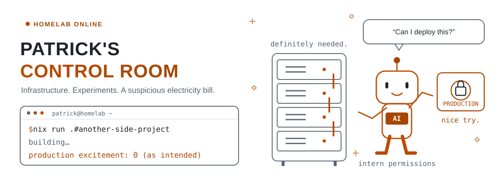
</picture>
</p>

<p align="center" id="intro">
<picture>
  <source media="(prefers-color-scheme: dark)" srcset=".github/assets/headings/intro-dark.svg">
  <source media="(prefers-color-scheme: light)" srcset=".github/assets/headings/intro-light.svg">
  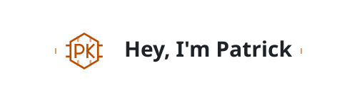
</picture>
</p>

<p align="center">
  <strong>I build the platforms other people deploy to.</strong><br>
  At home, I recreate the same problems with my own electricity bill.
</p>

<p align="center">
  <a href="https://patrick.kappen.io"><strong>🌍 Website</strong></a> &nbsp;·&nbsp;
  <a href="https://patrick.kappen.io/blog/">✍️ Blog</a> &nbsp;·&nbsp;
  <a href="https://www.linkedin.com/in/patrick-kappen/">💬 LinkedIn</a> &nbsp;·&nbsp;
  <a href="https://patrick.kappen.io/rss.xml">📡 RSS</a>
</p>

I’m a DevOps Engineer at **SLTN**, an Azure Expert MSP, working on Azure landing
zones, infrastructure as code and automation. Bicep and Terraform are a regular
part of that: building a foundation, organising configuration, and making
changes repeatable rather than dependent on someone remembering which buttons
to click.

The part I enjoy most is thinking through the difficult bits. How should the
pieces fit together? What belongs in a shared foundation, and what should a
workload manage itself? How do you balance security, flexibility and
maintainability without making everything unnecessarily complicated?

That work isn’t always about writing more code. Sometimes it’s tracing an
unexpected interaction, questioning an assumption, or taking a complicated
requirement apart until there’s an understandable approach. I like understanding
why something works—not just finding the configuration that makes the error
disappear.

The aim is infrastructure that other people can use, change and look after.
Something that makes sense beyond the person who originally built it, including
when that person is on holiday.

After hours, that curiosity moves into my homelab. NixOS, containers, self-hosted
services and open-weight coding agents give me plenty of opportunities to ask,
“Could I automate this?” Usually followed by, “Was automating this actually
necessary?”

The agents get a sandbox, a reviewer and useful work to do. They do not get
production keys. Enthusiasm is not an access-control policy.

```nix
patrick = {
  infrastructure = "as code";
  agents.productionKeys = false;
  restores = "actually tested";
  "just-one-more-server" = true;
};
```

<p align="center" id="beyond">
<picture>
  <source media="(prefers-color-scheme: dark)" srcset=".github/assets/headings/beyond-dark.svg">
  <source media="(prefers-color-scheme: light)" srcset=".github/assets/headings/beyond-light.svg">
  
</picture>
</p>

I don’t always stop at configuring a tool. Sometimes the thing I need is
missing—or behaves differently once you use it with a different identity.

That has taken me into Terraform provider development: working on GitHub App
authentication for enterprise organisation resources and Advanced Security
configuration in Azure DevOps. It also meant publishing my own provider forks.
Not because maintaining a second provider sounds like a relaxing hobby, but
because contributing upstream and needing something usable today are two
different timelines.

The same curiosity shows up in smaller things. When I separated my work and
personal GitHub accounts, I wanted the directory to decide which identity Git
and `gh` should use. No account-switching ritual before every push. Getting
there involved Nix, Home Manager, credential helpers, and discovering that an
empty configuration line could be the most important line in the file.

<p align="center" id="agents">
<picture>
  <source media="(prefers-color-scheme: dark)" srcset=".github/assets/headings/agents-dark.svg">
  <source media="(prefers-color-scheme: light)" srcset=".github/assets/headings/agents-light.svg">
  
</picture>
</p>

My interest in AI goes beyond asking a model to generate code. I also work on
**[PiG](https://github.com/Patrick-Kappen/PiG)**, a Go port of the Pi coding agent,
where matching upstream behaviour is part of the engineering challenge.

That includes extension SDK behaviour: making sure tool-result handlers receive
the input they should, including changes made earlier in the execution flow.
Less spectacular than a demo video, perhaps. Rather important when other code
depends on it.

<p align="center" id="personal">
<picture>
  <source media="(prefers-color-scheme: dark)" srcset=".github/assets/headings/personal-dark.svg">
  <source media="(prefers-color-scheme: light)" srcset=".github/assets/headings/personal-light.svg">
  
</picture>
</p>

For years, my personal and professional GitHub activity shared an account. I
separated them because I wanted somewhere for my own projects, contributions,
experiments and writing.

This is that place. The day job explains part of what I do. The repositories,
rabbit holes and suspicious electricity bill explain rather more.

<p align="center" id="approach">
<picture>
  <source media="(prefers-color-scheme: dark)" srcset=".github/assets/headings/approach-dark.svg">
  <source media="(prefers-color-scheme: light)" srcset=".github/assets/headings/approach-light.svg">
  
</picture>
</p>

I like infrastructure that can be reproduced, permissions that can be explained,
and changes that leave a useful trail.

- **Configuration belongs in Git.** “I changed something in the portal” is not
  documentation.
- **Access should be deliberate.** Preferably temporary, rather than inherited
  from an emergency three years ago.
- **Automation still needs judgement.** A successful pipeline and a sensible
  change are not necessarily the same thing.
- **Recovery matters.** A backup is reassuring. A working restore is
  considerably more useful.

Boring in production. Interesting in the pull request.

<!-- projects:start -->

<p align="center" id="projects">
<picture>
  <source media="(prefers-color-scheme: dark)" srcset=".github/assets/headings/projects-dark.svg">
  <source media="(prefers-color-scheme: light)" srcset=".github/assets/headings/projects-light.svg">
  
</picture>
</p>

Some experiments become projects. Others become focused contributions to tools I
already use.

I enjoy both sides: figuring out how a larger system fits together, and fixing
the small thing that makes someone’s everyday workflow unnecessarily awkward.
Build behaviour, developer tooling, automation and agent workflows tend to
attract my attention.

The cards below show recent public work—including whether a PR is still open,
has merged, or a release has been published.

<p align="center">
<a href="https://github.com/Patrick-Kappen/PiG">
<picture>
  <source media="(prefers-color-scheme: dark)" srcset=".github/assets/project-1-dark.svg">
  <source media="(prefers-color-scheme: light)" srcset=".github/assets/project-1-light.svg">
  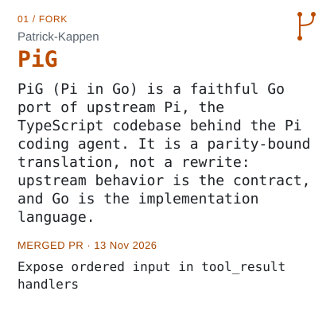
</picture>
</a>
<a href="https://github.com/Patrick-Kappen/paseo">
<picture>
  <source media="(prefers-color-scheme: dark)" srcset=".github/assets/project-2-dark.svg">
  <source media="(prefers-color-scheme: light)" srcset=".github/assets/project-2-light.svg">
  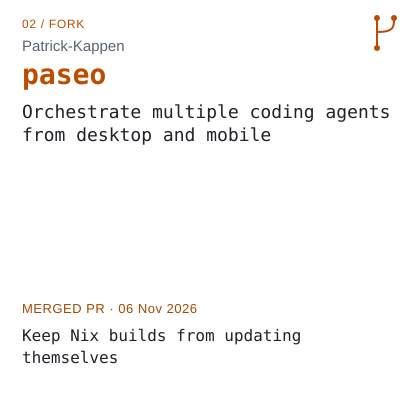
</picture>
</a>
</p>

<p align="center">
<a href="https://github.com/oxsecurity/megalinter">
<picture>
  <source media="(prefers-color-scheme: dark)" srcset=".github/assets/project-3-dark.svg">
  <source media="(prefers-color-scheme: light)" srcset=".github/assets/project-3-light.svg">
  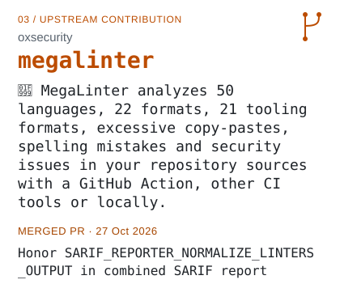
</picture>
</a>
<a href="https://github.com/Patrick-Kappen/terraform-provider-azuredevops">
<picture>
  <source media="(prefers-color-scheme: dark)" srcset=".github/assets/project-4-dark.svg">
  <source media="(prefers-color-scheme: light)" srcset=".github/assets/project-4-light.svg">
  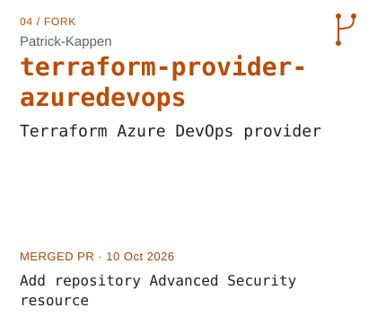
</picture>
</a>
</p>

<p align="center">
<a href="https://github.com/integrations/terraform-provider-github">
<picture>
  <source media="(prefers-color-scheme: dark)" srcset=".github/assets/project-5-dark.svg">
  <source media="(prefers-color-scheme: light)" srcset=".github/assets/project-5-light.svg">
  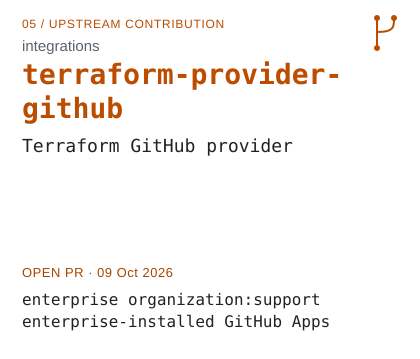
</picture>
</a>
<a href="https://github.com/Azure/terraform-azurerm-avm-res-recoveryservices-vault">
<picture>
  <source media="(prefers-color-scheme: dark)" srcset=".github/assets/project-6-dark.svg">
  <source media="(prefers-color-scheme: light)" srcset=".github/assets/project-6-light.svg">
  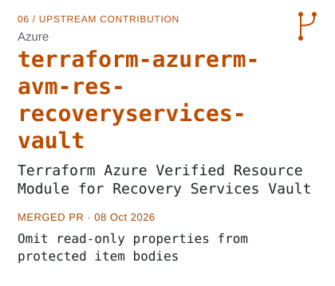
</picture>
</a>
</p>

<sub>Automatically refreshed 2026-11-13 · UTC · scheduled every 30 minutes.</sub>

<!-- projects:end -->

<!-- auto:start -->

<p align="center" id="git-log">
<picture>
  <source media="(prefers-color-scheme: dark)" srcset=".github/assets/headings/git-log-dark.svg">
  <source media="(prefers-color-scheme: light)" srcset=".github/assets/headings/git-log-light.svg">
  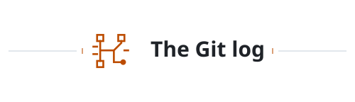
</picture>
</p>

<picture>
  <source media="(prefers-color-scheme: dark) and (max-width: 600px)" srcset=".github/assets/git-activity-compact-dark.svg">
  <source media="(prefers-color-scheme: light) and (max-width: 600px)" srcset=".github/assets/git-activity-compact-light.svg">
  <source media="(prefers-color-scheme: dark)" srcset=".github/assets/git-activity-dark.svg">
  <source media="(prefers-color-scheme: light)" srcset=".github/assets/git-activity-light.svg">
  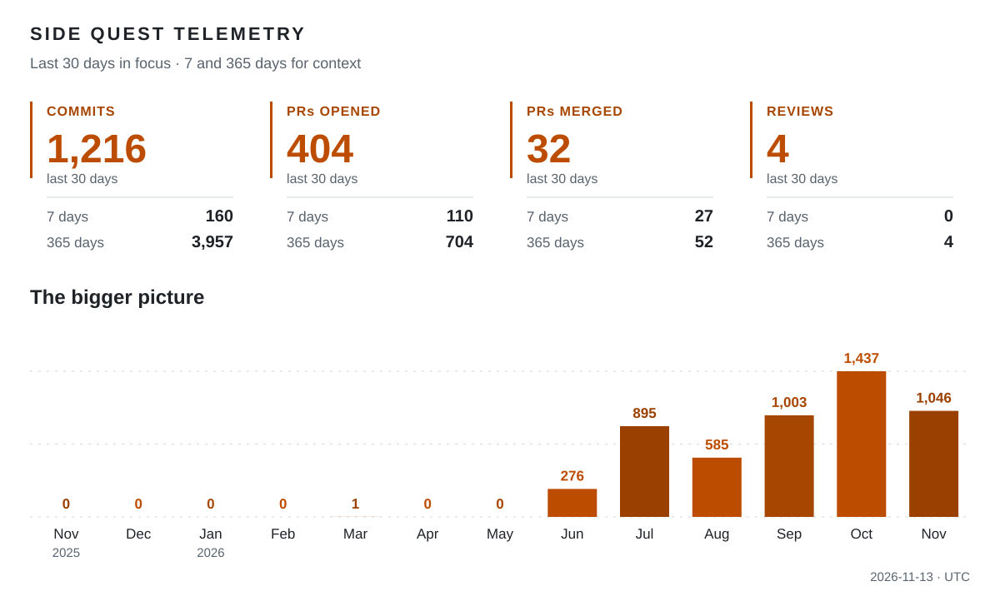
</picture>

<p align="center" id="shipped">
<picture>
  <source media="(prefers-color-scheme: dark)" srcset=".github/assets/headings/shipped-dark.svg">
  <source media="(prefers-color-scheme: light)" srcset=".github/assets/headings/shipped-light.svg">
  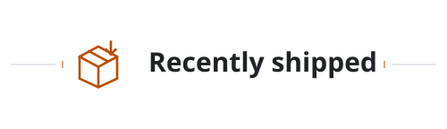
</picture>
</p>

<!-- shipped:start -->

<p><strong>MERGED PR #39</strong> · <code>Patrick-Kappen/PiG</code> · 13 Nov 2026<br><a href="https://github.com/Patrick-Kappen/PiG/pull/39"><strong>Expose ordered input in tool_result handlers</strong></a><br>The SDK now extracts the existing raw input for both tool events. ctx.ToolInput() and ctx.ToolParams() work in tool_result too. Mutation replies remain exclusive to tool_call. No host, wire-contract or exported signature change.</p>
<p><strong>MERGED PR #38</strong> · <code>Patrick-Kappen/PiG</code> · 13 Nov 2026<br><a href="https://github.com/Patrick-Kappen/PiG/pull/38"><strong>Preserve lone surrogate units in tool_call input</strong></a><br>Use the existing UTF-16-preserving SDK JSON decoder for the Session&#x27;s event input and subprocess handler replies, and its encoder for the Session&#x27;s before/after value snapshots. No wire shape, SDK API, async ordering, cancellation, or lifetime change. Ordinary inputs and…</p>
<p><strong>MERGED PR #3</strong> · <code>Patrick-Kappen/paseo</code> · 06 Nov 2026<br><a href="https://github.com/Patrick-Kappen/paseo/pull/3"><strong>Keep Nix builds from updating themselves</strong></a></p>
<p><strong>MERGED PR #1</strong> · <code>Patrick-Kappen/paseo</code> · 02 Nov 2026<br><a href="https://github.com/Patrick-Kappen/paseo/pull/1"><strong>Add an Azure DevOps forge adapter</strong></a></p>
<p><strong>MERGED PR #9338</strong> · <code>oxsecurity/megalinter</code> · 27 Oct 2026<br><a href="https://github.com/oxsecurity/megalinter/pull/9338"><strong>Honor SARIF_REPORTER_NORMALIZE_LINTERS_OUTPUT in combined SARIF report</strong></a><br>The per-linter SARIF reports already check SARIF_REPORTER_NORMALIZE_LINTERS_OUTPUT before stripping the workspace prefix (megalinter/utils_sarif.py), but the combined report in SarifReporter.produce_report normalized unconditionally.</p>
<p><strong>MERGED PR #9258</strong> · <code>oxsecurity/megalinter</code> · 27 Oct 2026<br><a href="https://github.com/oxsecurity/megalinter/pull/9258"><strong>Count a linter stopped by a signal as failed (#9257)</strong></a><br>Python gives a sub-process that a signal stops (for example an out-of-memory kill) a negative return code. Two checks used &gt; 0 and so treated that as success.</p>
<p><strong>MERGED PR #2</strong> · <code>Patrick-Kappen/terraform-provider-azuredevops</code> · 10 Oct 2026<br><a href="https://github.com/Patrick-Kappen/terraform-provider-azuredevops/pull/2"><strong>Add repository Advanced Security resource</strong></a></p>
<p><strong>MERGED PR #271</strong> · <code>Azure/terraform-azurerm-avm-res-recoveryservices-vault</code> · 08 Oct 2026<br><a href="https://github.com/Azure/terraform-azurerm-avm-res-recoveryservices-vault/pull/271"><strong>Omit read-only properties from protected item bodies</strong></a><br>With the current AzAPI provider (reproduced with v2.13.0), terraform plan fails for every protected VM and protected file share, not only after upgrading from 1.1.x:</p>

<!-- shipped:end -->

<p align="center" id="now">
<picture>
  <source media="(prefers-color-scheme: dark)" srcset=".github/assets/headings/now-dark.svg">
  <source media="(prefers-color-scheme: light)" srcset=".github/assets/headings/now-light.svg">
  
</picture>
</p>

- Studying for GitHub Actions and AI-103
- Building a blog on patrick.kappen.io

_Updated Oct 2026. Side quests subject to change._

<p align="center" id="writing">
<picture>
  <source media="(prefers-color-scheme: dark)" srcset=".github/assets/headings/writing-dark.svg">
  <source media="(prefers-color-scheme: light)" srcset=".github/assets/headings/writing-light.svg">
  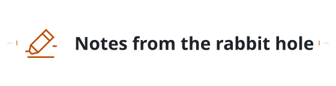
</picture>
</p>

I write about the things that took some figuring out: contributions, tooling and
configurations worth explaining before I forget why they work.

- [Contributing to a Terraform provider: preparation](https://patrick.kappen.io/blog/contributing-to-a-terraform-provider-preparation/)<br>
  You hit a bug or a missing resource in a Terraform provider. How to check
  whether you can fix it, which accounts you need and where to create them, and
  what the road from fork to merge looks like.
- [Two GitHub accounts, one machine, zero switching](https://patrick.kappen.io/blog/two-github-accounts-by-directory/)<br>
  I split my GitHub life in two and refused to switch accounts by hand ever
  again. Nix made it easy, git and gh made it interesting.

<!-- auto:end -->

<!-- site:start -->

<p align="center" id="tools">
<picture>
  <source media="(prefers-color-scheme: dark)" srcset=".github/assets/headings/tools-dark.svg">
  <source media="(prefers-color-scheme: light)" srcset=".github/assets/headings/tools-light.svg">
  
</picture>
</p>

Azure for the day job. Terraform and Bicep for infrastructure. GitHub Actions
and PowerShell for the repetitive parts. NixOS for reproducible experiments—and
occasionally for discovering exactly how much configuration one person can
justify.

<p align="center">
<picture>
  <source media="(prefers-color-scheme: dark)" srcset=".github/assets/tools/azure-dark.svg">
  <source media="(prefers-color-scheme: light)" srcset=".github/assets/tools/azure-light.svg">
  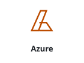
</picture>
<picture>
  <source media="(prefers-color-scheme: dark)" srcset=".github/assets/tools/terraform-dark.svg">
  <source media="(prefers-color-scheme: light)" srcset=".github/assets/tools/terraform-light.svg">
  
</picture>
<picture>
  <source media="(prefers-color-scheme: dark)" srcset=".github/assets/tools/bicep-dark.svg">
  <source media="(prefers-color-scheme: light)" srcset=".github/assets/tools/bicep-light.svg">
  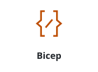
</picture>
<picture>
  <source media="(prefers-color-scheme: dark)" srcset=".github/assets/tools/github-actions-dark.svg">
  <source media="(prefers-color-scheme: light)" srcset=".github/assets/tools/github-actions-light.svg">
  
</picture>
<picture>
  <source media="(prefers-color-scheme: dark)" srcset=".github/assets/tools/nixos-dark.svg">
  <source media="(prefers-color-scheme: light)" srcset=".github/assets/tools/nixos-light.svg">
  
</picture>
<picture>
  <source media="(prefers-color-scheme: dark)" srcset=".github/assets/tools/kubernetes-dark.svg">
  <source media="(prefers-color-scheme: light)" srcset=".github/assets/tools/kubernetes-light.svg">
  
</picture>
<picture>
  <source media="(prefers-color-scheme: dark)" srcset=".github/assets/tools/powershell-dark.svg">
  <source media="(prefers-color-scheme: light)" srcset=".github/assets/tools/powershell-light.svg">
  
</picture>
<picture>
  <source media="(prefers-color-scheme: dark)" srcset=".github/assets/tools/podman-dark.svg">
  <source media="(prefers-color-scheme: light)" srcset=".github/assets/tools/podman-light.svg">
  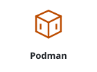
</picture>
<picture>
  <source media="(prefers-color-scheme: dark)" srcset=".github/assets/tools/litellm-dark.svg">
  <source media="(prefers-color-scheme: light)" srcset=".github/assets/tools/litellm-light.svg">
  
</picture>
<picture>
  <source media="(prefers-color-scheme: dark)" srcset=".github/assets/tools/proxmox-dark.svg">
  <source media="(prefers-color-scheme: light)" srcset=".github/assets/tools/proxmox-light.svg">
  
</picture>
<picture>
  <source media="(prefers-color-scheme: dark)" srcset=".github/assets/tools/ubuntu-dark.svg">
  <source media="(prefers-color-scheme: light)" srcset=".github/assets/tools/ubuntu-light.svg">
  
</picture>
<picture>
  <source media="(prefers-color-scheme: dark)" srcset=".github/assets/tools/azure-devops-dark.svg">
  <source media="(prefers-color-scheme: light)" srcset=".github/assets/tools/azure-devops-light.svg">
  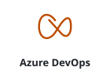
</picture>
<picture>
  <source media="(prefers-color-scheme: dark)" srcset=".github/assets/tools/ansible-dark.svg">
  <source media="(prefers-color-scheme: light)" srcset=".github/assets/tools/ansible-light.svg">
  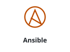
</picture>
<picture>
  <source media="(prefers-color-scheme: dark)" srcset=".github/assets/tools/phoenix-dark.svg">
  <source media="(prefers-color-scheme: light)" srcset=".github/assets/tools/phoenix-light.svg">
  
</picture>
<picture>
  <source media="(prefers-color-scheme: dark)" srcset=".github/assets/tools/grafana-dark.svg">
  <source media="(prefers-color-scheme: light)" srcset=".github/assets/tools/grafana-light.svg">
  
</picture>
<picture>
  <source media="(prefers-color-scheme: dark)" srcset=".github/assets/tools/truenas-dark.svg">
  <source media="(prefers-color-scheme: light)" srcset=".github/assets/tools/truenas-light.svg">
  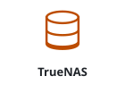
</picture>
<picture>
  <source media="(prefers-color-scheme: dark)" srcset=".github/assets/tools/tailscale-dark.svg">
  <source media="(prefers-color-scheme: light)" srcset=".github/assets/tools/tailscale-light.svg">
  
</picture>
<picture>
  <source media="(prefers-color-scheme: dark)" srcset=".github/assets/tools/traefik-dark.svg">
  <source media="(prefers-color-scheme: light)" srcset=".github/assets/tools/traefik-light.svg">
  
</picture>
</p>

<details>
<summary><strong>The longer version, including the certificates</strong></summary>

<p align="center" id="toolbox">
<picture>
  <source media="(prefers-color-scheme: dark)" srcset=".github/assets/headings/toolbox-dark.svg">
  <source media="(prefers-color-scheme: light)" srcset=".github/assets/headings/toolbox-light.svg">
  
</picture>
</p>

- **Cloud:** Azure
- **Automation & delivery:** Terraform · Bicep · GitHub Actions · PowerShell ·
  Azure DevOps · Ansible
- **NixOS & deployment:** NixOS
- **Linux:** Ubuntu
- **Containers & orchestration:** Kubernetes · Podman
- **AI:** LiteLLM · Phoenix
- **Datacenter & virtualisation:** Proxmox
- **Networking:** Tailscale · Traefik
- **Storage & backup:** TrueNAS
- **Monitoring:** Grafana

<p align="center" id="certifications">
<picture>
  <source media="(prefers-color-scheme: dark)" srcset=".github/assets/headings/certifications-dark.svg">
  <source media="(prefers-color-scheme: light)" srcset=".github/assets/headings/certifications-light.svg">
  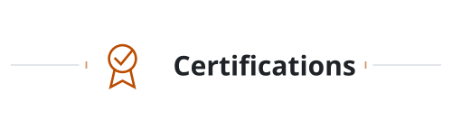
</picture>
</p>

- **Certified:**
  [AZ-900](https://www.credly.com/badges/c864e7a2-1536-4183-9e0c-c5cd841b2088) ·
  [AZ-104](https://www.credly.com/badges/103f1099-a80a-4544-8c95-45b80edbf2ad) ·
  [AZ-400](https://www.credly.com/badges/5bd5f444-199c-4ee5-8177-43427a8ad8ce)
- **Working towards:** GitHub Actions · AI-103

</details>

<!-- site:end -->

<sub>Every change reviewed. Every restore tested. Every “quick experiment” suspicious.</sub>

<!-- markdownlint-enable MD013 MD033 -->
